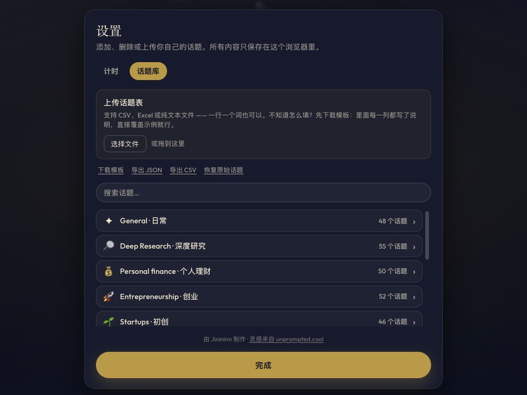

# 交谈话题 Conversation Starter

[English](README.md) · **中文**

一个练口才的小工具：抽一个话题，然后对着计时器讲。

这个版本的重点是**话题库**。它自带约 250 条中英双语话题，但这些只是起点——你可以上传
自己的表格或文本文件：语言课的生词、面试题、辩论题目、工作坊的提示词，上传后它就成了
你抽取的话题库。所有内容只存在你自己的浏览器里，不会上传到任何地方。

<table>
  <tr>
    <td width="50%"></td>
    <td width="50%"></td>
  </tr>
  <tr>
    <td align="center"><sub>抽一个话题，然后对着计时器讲。</sub></td>
    <td align="center"><sub>选「中文」同时切换界面语言<em>和</em>题库。</sub></td>
  </tr>
  <tr>
    <td width="50%"></td>
    <td width="50%"></td>
  </tr>
  <tr>
    <td align="center"><sub>上传一张表格，换成你自己的话题库。</sub></td>
    <td align="center"><sub>演讲和查资料计时，以整分钟为单位。</sub></td>
  </tr>
</table>

```bash
npm install
npm run dev      # http://localhost:5173
```

> **只是想用，不想装开发环境？**
> 看 [离线发行版](#离线发行版)——一个 HTML 文件，双击就能用，不用联网。

## 它能做什么

**三种模式。** *即兴开讲*抽完题直接进入演讲计时，「是什么？/ 所以呢？/ 然后呢？」三个
提示分别在时间过了三分之一和三分之二时亮起。*深度研究*先给一段查资料的时间——边查边记
一行一条的笔记，在不限时的停顿里把它们整理成要点，讲完再复盘，整个过程可以导出成一份
Markdown 笔记。*速练*专为刷词库设计：每轮只有几十秒，时间一到自评一下这轮说得怎么样
——吃力、还行、流畅——马上进入下一个词。自评衡量的是表达是否流畅，从不判断对错；
没有「待复习」队列，也没有欠着的任务。

**练习会留下记录。** 每一轮练完都会在你的浏览器里存一条记录——话题、模式、你写下的
内容——这是之后进度视图的原材料。和词库一样，它永远不会离开你的设备。

**三个地区**，是叠加关系而不是互斥关系：

| 地区 | 题库 | 界面 |
|---|---|---|
| English | 通用话题的英文面 | 英文 |
| Singapore | 通用话题 + 新加坡专属补充 | 英文 |
| 中文 | 通用话题的中文面 + 大陆专属补充 | 中文 |

选「中文」会把整个界面切换成中文——地区同时决定题库和语言，所以只有一个开关需要操心。
浏览器语言是中文时，首次打开**默认就是中文**。

## 上传你自己的话题库

**设置 → 话题库 → 上传话题表。** 拖进一个文件，看一眼预览，然后选择是添加到现有话题
还是全部替换。在你确认之前不会写入任何东西。

支持格式：`.csv`、`.tsv`、`.txt`、`.xlsx`、`.xls`、`.json`（从本工具导出的话题库）。

### 最简单的做法

一个纯文本文件，一行一个话题：

```
怀旧
你最近一次改变主意是什么时候
一件你后来发现自己错了的事
```

这些会进入你在导入面板里选的分类和地区。

### 完整格式

带表头的表格或 CSV。**每一列都可以留空**，留空的部分会用面板里选的值：

| 列 | 含义 | 留空时 |
|---|---|---|
| `category` | 话题属于哪个分类 | 放入「日常」 |
| `en` | 英文话题 | 用 `zh` 的内容 |
| `zh` | 中文话题 | 用 `en` 的内容 |
| `region` | `shared`、`singapore` 或 `china` | 用面板里选的地区 |

```csv
category,en,zh,region
日常,Nostalgia,怀旧,shared
日常,The best kopi order,,singapore
健身,Cold plunges,冷水浴,shared
健身,,晨跑还是夜跑,china
```

表头是宽松匹配的，**中英文都认**——`english`、`topic`、`word`、`meaning`、`中文`、
`分类`、`地区` 之类都能识别，所以一张两列的生词表（`单词` / `释义`）可以直接导入。
如果完全没有可识别的表头，第一列当作英文，第二列当作中文。

几个值得知道的行为：

- **分类会按需创建。** `category` 填了一个不存在的分类名，就会新建一个；填了已有的
  名字，就并入那一个。
- **重复的会跳过**，忽略大小写和空格，既比对你已有的话题库，也比对上传文件内部。
- **只有一种语言的行会自动镜像。** 一条 shared 话题只填了英文，中文那一面会复用同样的
  文本，这样它在每个地区都抽得到，而不是在某个地区凭空消失。预览里会告诉你这影响了
  多少行。

面板里的**下载模板**会给你一个起始文件。模板带一个 `notes` 列逐行解释格式——导入器会
忽略它不认识的列，所以这一列你留着或删掉都行，反正它永远不会变成话题。把示例覆盖掉
再上传即可。中文界面下载到的是中文版模板。

模板导出时带 UTF-8 字节序标记（BOM），这样 Excel 打开中文不会变成乱码；导入时再把它
去掉。

### 把话题库导出来

**导出 JSON** 能完整还原，适合留作备份。**导出 CSV** 给你一个能在 Excel 或表格软件里
编辑的版本，本导入器能原样读回。**恢复原始话题**会还原成自带的话题库。

如果你想改的是项目自带的话题（而不只是你自己那份），直接改组成自带库的文件：
`src/data/topics/` 下一个分类一个 JSON 文件，`src/data/topics.json` 只记录要加载哪些
文件、界面上按什么顺序排。新增一个分类就是加文件、并在清单里写上它——写了名字却没有
对应文件会启动即失败，`npm run verify` 会核对清单和文件夹是否一致。

## 你的话题存在哪

存在 `localStorage` 里，键名前缀 `conversation-starter:`，就在你用的那个浏览器里。
没有账号，也没有服务器。这意味着：

- 清除网站数据会清掉你的话题库——**先导出备份**。
- 换一个浏览器或换一台设备，会从自带的话题重新开始。
- 你写的任何东西对别人都不可见，包括作者。

## 转盘是怎么转的

4800 毫秒，`easeOutCubic` 缓动，步数为 `圈数 × 转盘长度 + 偏移`，每变化一步响一声，
落点在开始时就已经定好。

步数会随题库大小变化，所以一个很大的话题库转起来会明显比小的密集。与其改公式，不如
每次抽取都从完整题库里采样一个 **30 条的转盘**，再对这 30 条套用公式。这样每个题库的
节奏都一样，每条话题都抽得到，而且概率保持均匀（`30/n × 1/30 = 1/n`）——
`scripts/verify-reel.ts` 用卡方检验验证了这一点。

## 构建

```bash
npm run build     # 类型检查 + 打包到 dist/
npm run preview   # 本地预览构建结果
```

资源使用相对路径，所以 `dist/` 可以放在 GitHub Pages 这种子路径主机上。但它仍然需要
**一个服务器**：浏览器不允许通过 `file://` 加载 ES 模块，直接双击 `dist/index.html`
只会得到一个白页。想要能直接双击运行的版本，用下面的单文件构建。

### 单文件构建

```bash
npm run build:single   # 生成 "Conversation Starter.html"
```

脚本、样式、字体、图标全部内联进一个 HTML 文件，双击即可运行，不需要服务器、不需要
安装、**完全不发任何网络请求**。内联的 `<script type="module">` 不需要被「获取」，
这正是它绕开 `file://` 限制的原理。

### 离线发行版

```bash
npm run pack:china   # 生成 交谈话题-离线版.zip
```

GitHub Pages 在中国大陆不稳定甚至无法访问，所以面向国内用户的分发方式是一个放在
百度网盘的压缩包：重命名为 `交谈话题.html` 的单文件、一份中文使用说明、一个 README，
以及字体许可证。源文件在 `packaging/` 目录下。

`scripts/pack-china.ts` 是手写 zip 格式而不是调用 `zip` 命令的——macOS 自带的
Info-ZIP 编译时没有开 Unicode 支持，它会存储 UTF-8 的文件名却不设置标记位，于是中文
Windows 按 GBK 解码，全部变成乱码。脚本会设置这个标记位并在写完后校验。README.txt
带 UTF-8 BOM 和 CRLF 换行也是同样的道理：不然记事本会猜错编码。

## 字体

Fraunces、Outfit 和 Noto Sans SC 都是**自托管**的，放在 `public/fonts/`。它们原本
来自 Google Fonts，那是这个应用唯一的外部请求——在国内被墙，页面会卡在一个阻塞渲染的
样式表上，然后悄悄地丢掉 Noto Sans SC 900，也就是中文话题所用的那个字重。
`tokens.css` 里设了 `font-synthesis: none`，所以连合成粗体都没有，损失非常明显。

```bash
npm run build:fonts   # 重新生成字体子集
```

Fraunces 和 Outfit 保留可变字体形式（只保留实际用到的字重范围），子集化为拉丁字符。
Noto Sans SC 固定为静态 900 字重，子集为 GB2312 一级汉字（最常用的 3755 字）并合并
自带话题库里出现的所有字符——**560KB，而不是 17MB**。如果导入的话题用到了更生僻的字，
那个字会回退到 PingFang SC 或微软雅黑。

三款字体均以 SIL Open Font License 1.1 发布，见 `public/fonts/OFL.txt`。

## 验证

```bash
npm run typecheck     # 同时强制两种语言的字典都不缺条目
npm run verify        # 状态机、时间工具函数、话题库完整性
npm run verify:reel   # 抽取分布是否均匀、有没有抽不到的话题
npm run verify:import # CSV 解析和合并逻辑，端到端
```

## 致谢

由 **Jinininn** 制作。

灵感来自 [unprompted.cool](https://www.unprompted.cool/)，那是最初的想法，值得一看。
本项目是独立重新实现的版本，扩展了地区题库、完整的中文界面，以及上面介绍的可上传
话题库。

MIT 许可证 —— 见 [LICENSE](LICENSE)。
